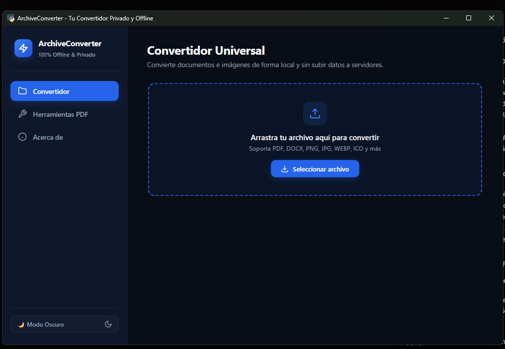

# ⚡ ArchiveConverter Desktop

> **Tu convertidor y caja de herramientas de archivos 100% privado, offline y sin anuncios.**


<p align="center">
  
</p>

---

## 🌟 ¿Por qué ArchiveConverter?

La mayoría de convertidores online tienen graves problemas:
* 🛑 **Riesgos de privacidad:** Subes contratos, identificaciones y documentos de tu empresa a servidores de terceros desconocidos.
* 🛑 **Publicidad invasiva:** Pantallas llenas de anuncios fraudulentos y botones falsos de descarga.
* 🛑 **Límites arbitrarios:** Cobros de suscripción o bloqueos si tu archivo pesa más de 5 MB.
* 🛑 **Conversiones mediocres:** Pegan una captura de imagen en lugar de extraer texto editable, o cortan las tablas de Excel en páginas sueltas.

**ArchiveConverter** procesa **todo localmente en la memoria de tu computadora**. No requiere internet, no almacena telemetría y es completamente gratuito y de código abierto.

---

## 🚀 Características Principales

### 📁 1. Convertidor Universal y por Lotes (Batch Mode)
* **Arrastrar y soltar:** Suelta uno o 20 archivos simultáneamente desde el Explorador de Windows.
* **Integración con el Menú Contextual:** Haz clic derecho sobre cualquier archivo en el explorador $\to$ *"Convertir con ArchiveConverter"* para abrirlo al instante.
* **Notificaciones de Escritorio:** Avisos nativos del sistema al finalizar conversiones extensas o tareas por lotes.
* **Documentos:**
  * **PDF $\to$ Word (DOCX):** Reconstrucción estructural real (párrafos, tablas y fuentes editables, no capturas de imagen).
  * **Word $\to$ PDF:** Exportación nativa con máxima fidelidad visual y soporte para firmas.
  * **Excel $\to$ PDF:** Algoritmo de **Auto-Ajuste Inteligente** (`FitToPagesWide = 1`) que calcula las columnas para que ninguna quede partida horizontalmente, con orientación dinámica (Landscape si la tabla es ancha).
  * **PowerPoint $\to$ PDF:** Exportación diapositiva a diapositiva en calidad vectorial nítida.
* **Fotos e Imágenes:**
  * Soporte nativo para **fotos de iPhone (`.HEIC` / `.HEIF`)** a JPG, PNG, WEBP o PDF.
  * Conversión entre PNG, JPG, WEBP, ICO, BMP, TIFF.
* **Optimizador de Imágenes:** Comprime imágenes indicando un peso máximo objetivo (ej: *máximo 500 KB o 1 MB* para trámites web).

---

### ✨ 2. Removedor de Fondos con IA en Local
* Segmentación inteligente con modelos de visión por computadora basados en ONNX.
* Aísla personas, productos, firmas y logos para generar un **PNG con fondo 100% transparente** en 1-2 segundos sin subir la foto a ningún servidor.

---

### 🛠️ 3. Caja de Herramientas PDF Avanzada
* 🔗 **Unir (Merge):** Combina múltiples PDFs en el orden deseado.
* ✂️ **Dividir (Split):** Separa todas las páginas o extrae rangos específicos (ej: `1-3`).
* 🗜️ **Comprimir (Compress):** Reduce el peso del documento optimizando flujos internos sin pérdida visual perceptible.
* 🖼️ **Extraer Fotos:** Exporta todas las imágenes internas del PDF en resolución nativa.
* 🔄 **Rotar:** Corrige la orientación en 90°, 180° o 270°.
* 💧 **Marca de Agua:** Estampa textos como *"CONFIDENCIAL"* o *"COPIA"* en diagonal con opacidad suave en todas las páginas.
* ✍️ **Firmar Documento:** Estampa la imagen de tu firma o sello en la esquina o posición elegida.
* 🔒 **Seguridad:** Cifra con clave de grado militar **AES-256** o desbloquea PDFs protegidos.

---

## 💻 Descarga e Instalación

### Opción A: Versión Portable (Recomendada - Sin instalación)
1. Descarga el archivo `ArchiveConverter-v1.1.0-Portable-Windows.zip` desde la sección de **Releases**.
2. Descomprímelo en cualquier carpeta o memoria USB.
3. Haz doble clic en `ArchiveConverter.exe` para abrir el programa de inmediato.

### Opción B: Instalador de Windows (`Setup.exe`)
1. Descarga `ArchiveConverter-Setup-v1.1.0.exe`.
2. Sigue el asistente de instalación clásico (crea acceso directo en el escritorio y desinstalador en el Panel de Control).

---

## 🛠️ Ejecución desde el Código Fuente (Desarrolladores)

Si deseas clonar el repositorio y ejecutarlo o mejorarlo:

```powershell
# 1. Clonar el repositorio
git clone https://github.com/SirDurand1708/ArchiveConverter.git
cd ArchiveConverter

# 2. Crear entorno virtual
python -m venv .venv
.\.venv\Scripts\activate

# 3. Instalar dependencias
pip install -r requirements.txt

# 4. Iniciar la interfaz gráfica
python main.py

# 5. O usar en modo terminal (CLI)
python main.py documento.pdf docx
python main.py merge doc1.pdf doc2.pdf -o salida.pdf
python main.py compress reporte.pdf
```

### Ejecutar Pruebas Automatizadas
```powershell
python -m unittest discover tests
```

---

## 🏗️ Compilar los Ejecutables por tu Cuenta

Para compilar el ejecutable portable y el instalador:

```powershell
# Instalar PyInstaller
pip install pyinstaller

# Generar ejecutable en dist/ArchiveConverter
pyinstaller ArchiveConverter.spec --noconfirm

# (Opcional) Compilar el instalador con Inno Setup
& "C:\Program Files (x86)\Inno Setup 6\ISCC.exe" installer\setup.iss
```

---

## 📜 Licencia

Distribuido bajo la Licencia **MIT**. Consulta el archivo [LICENSE](LICENSE) para más información.
